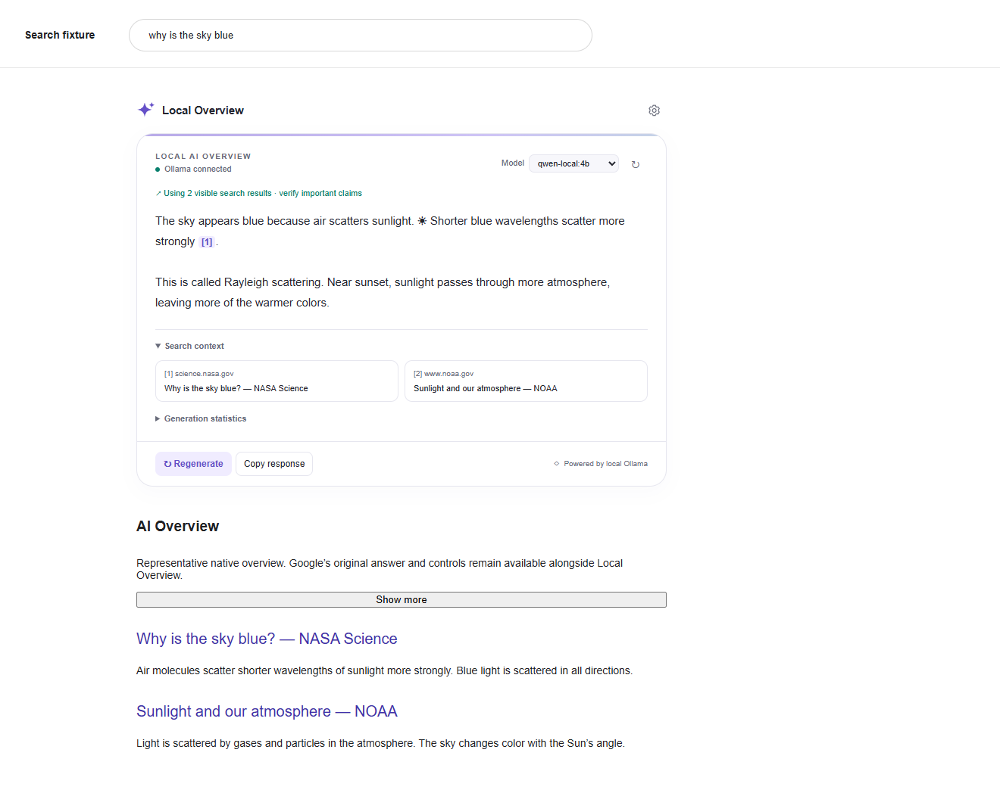
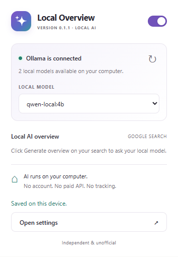

# Local Overview

**Your search. Your model. Your computer.**

Local Overview is an independent Chrome extension that adds a **Local AI Overview** to Google Search using a model installed in [Ollama](https://ollama.com/). The local panel appears alongside Google's original results and AI Overview, which stay available and unchanged.

Version **0.1.0** · Manifest V3 · TypeScript · No frontend framework · MIT

[Source repository](https://github.com/CTR495/local-overview) · [Release downloads](https://github.com/CTR495/local-overview/releases)

This project is unofficial and is not affiliated with, endorsed by, or sponsored by Google or Ollama.

## Features

- A dedicated Local AI panel that leaves Google's original AI Overview and search results untouched.
- Local generation works whether or not Google provides an overview for the query.
- Incremental Ollama streaming, cancellation, regeneration, and installed-model selection.
- Optional grounding in a limited set of visible result titles, URLs, and snippets; no extra result-page requests.
- Linked citations restricted to collected sources, plus a clear notice when current search context is unavailable.
- Light/dark appearance, reduced motion, original sparkle animation, responsive controls, popup, and full settings page.
- Optional statistics based on Ollama's reported timing and token counts.
- Loopback-only networking, no telemetry, no remote scripts, no paid API, and no custom backend.

## Screenshots

The search screenshots show the built Manifest V3 extension running in Chromium against a representative search-page fixture and a loopback HTTP Ollama mock. Extension APIs, service-worker requests, and port streaming are real in this test; Google content and model responses are controlled fixtures. They do not establish compatibility with Google's live page.



[View dark mode](docs/screenshots/google-dark.png). See the [screenshot notes](docs/screenshots/README.md) and [validation report](docs/VALIDATION.md) for the exact evidence and remaining live checks.



[View the options page screenshot](docs/screenshots/options.png). All four images show the actual unpacked extension with real Chrome APIs and controlled model discovery and responses from a loopback HTTP mock. They do not show a live Google page or a live Ollama session.

## Requirements

- Desktop Google Chrome **120 or later**. Other Chromium browsers may work but are not a supported test target for this release.
- A supported Google Search results page on `google.com` or `google.com.au`, with or without `www`, over HTTPS.
- [Ollama](https://ollama.com/download) running on the same computer, with at least one downloaded chat model.
- Enough RAM/VRAM for the chosen model. Generation speed depends on your computer and model.
- For building from source: Node.js **20.19+** and npm.

Image/video/shopping tabs, Google's AI Mode, embedded search frames, mobile browsers, and other Google regional domains are outside the initial support scope. See [manual validation](docs/TESTING.md) for the remaining live-browser checks.

## Install Ollama and a model

1. Install Ollama using the [official download instructions](https://ollama.com/download). Start the Ollama application, or run `ollama serve` if you manage it from a terminal.
2. Download a local chat model that fits your hardware. For example:

   ```sh
   ollama pull llama3.2:3b
   ollama list
   ```

   This is only an example. Local Overview discovers installed models dynamically; it has no fixed model allowlist. Use a chat-capable model rather than an embedding-only model. Model downloads need internet access and are performed by Ollama, outside the extension.

3. Disable Ollama's cloud features for a local-only setup: set `OLLAMA_NO_CLOUD=1` in the Ollama server's environment and restart Ollama. See [local access configuration](docs/OLLAMA.md).

The default endpoint is `http://localhost:11434`. You may configure another port on `localhost` or `127.0.0.1`; remote hosts, credentials, URL paths, queries, fragments, and redirects are rejected. Cloud-backed models are excluded. A local URL alone does not prove that a separately configured server will never forward data; keep cloud features disabled and use a genuine local Ollama server.

## Build and load the extension

Download or clone this repository, open a terminal in its directory, and run:

```sh
npm ci
npm run verify
```

For a fresh checkout without a lockfile during development, use `npm install` once. Published source includes a lockfile; prefer `npm ci` for repeatable installs.

1. Open **`chrome://extensions`** in Chrome.
2. Turn on **Developer mode** in the upper-right corner.
3. Select **Load unpacked**.
4. Choose the generated **`dist`** folder, not the source folder or a ZIP file.
5. Pin **Local Overview** using Chrome's Extensions menu if desired.
6. Open the extension popup, select **Settings**, and choose an installed local model. Use **Retry** to refresh the list if needed.
7. Open a fresh supported Google Search page. The **Local AI Overview** panel appears automatically. Use **Generate overview** if automatic generation is disabled or interaction is required.

If Ollama blocks the connection, allow the extension's exact origin using `OLLAMA_ORIGINS`. The origin and platform-specific setup are described in [docs/OLLAMA.md](docs/OLLAMA.md). Changing environment variables requires restarting Ollama.

GitHub hosting does **not** install an extension into Chrome. This release uses the unpacked installation steps above; it is not a Chrome Web Store listing. If you downloaded a packaged ZIP, extract it first and load the directory containing `manifest.json`.

After rebuilding, click **Reload** on the extension card in `chrome://extensions`, then reload existing Google tabs. A content script from an earlier extension version cannot safely continue after its extension context is invalidated.

## Using Local Overview

The local panel is available whenever the extension is enabled on a supported search page. Google's own overview and controls remain available independently; Local Overview does not hide or replace them. Select a model, generate or regenerate a response, stop generation, copy the answer, or open settings. Moving to another query, disabling the extension, or changing generation settings cancels the current request. The extension keeps completed answers only in the current page's memory; it does not create a persistent search or response history.

Grounding is **off by default**. Turn it on in settings to supply a small number of visible search results to the model. Source cards show the collected pages; inline numeric citations link only to those pages. Snippets are incomplete and models can misread them. Citation presence is not a guarantee that a claim is supported—open the original sources for decisions that matter. Without usable context, the panel identifies the answer as based on model knowledge rather than current search evidence.

Settings let you generate automatically when the panel opens, require an explicit **Generate overview** or **Regenerate** action, and control automatic generation on new queries. The popup's enable switch controls only Local Overview. Appearance changes update open interfaces through Chrome storage.

## Development

```sh
npm ci
npm run dev           # Watch TypeScript bundles; reload the extension after edits
npm run check         # TypeScript and formatting checks
npm test              # Mocked API, streaming, settings, and DOM tests
npm run build         # Build the unpacked extension into dist/
npm run verify        # Static checks, unit tests, build, and expected-file checks
npm run package       # Build and create the distributable ZIP in artifacts/
```

For the browser tests, install Playwright's Chromium once:

```sh
npx playwright install chromium
npm run test:browser
```

Browser tests use representative search fixtures and mocked Ollama responses. The [test guide](docs/TESTING.md) separates these checks from live Google and real-model testing. Never run test scenarios against a personal browser profile with sensitive tabs.

For 0.1.0, a separate browser check also streamed a genuine local Ollama model through the built extension against a search fixture. The maintainer reported that their manual live test worked. The automated live Google attempt encountered a traffic challenge; it did not establish live compatibility. See the [validation report](docs/VALIDATION.md) for the distinct results and their limits.

The build bundles local code with esbuild. There are no runtime npm dependencies, CDN assets, external font requests, or remote executable scripts. Generated files, dependencies, test outputs, and local configuration are excluded from Git.

### Project layout

```text
src/
  background/   Privileged API requests and extension message validation
  content/      Search lifecycle, local overview UI, and generation controls
  google/       Safe panel placement and visible result context
  ollama/       Ollama client, streaming parser, and grounded prompts
  pages/        Popup and options page logic and styling
  shared/       Settings, types, endpoint rules, and messaging contracts
scripts/        Build, packaging, and build verification
tests/          Unit tests and representative DOM fixtures
e2e/            Browser integration tests
docs/           Setup, architecture, testing, and screenshots
.github/        Continuous integration
```

See [architecture](docs/ARCHITECTURE.md) for lifecycle, security, and Google layout integration details. To add a Google domain, update the shared hostname list, manifest match patterns, sender validation, and tests together.

## Troubleshooting

| Symptom                                     | What to try                                                                                                                                                                                                              |
| ------------------------------------------- | ------------------------------------------------------------------------------------------------------------------------------------------------------------------------------------------------------------------------ |
| **Ollama is offline**                       | Start Ollama, verify the endpoint in Settings, then click Retry/Refresh models. The usual endpoint is `http://localhost:11434`.                                                                                          |
| Access denied / HTTP 403                    | Add the exact `chrome-extension://EXTENSION_ID` origin to `OLLAMA_ORIGINS` and restart Ollama. See [local access configuration](docs/OLLAMA.md).                                                                         |
| No models available                         | Run `ollama list`; download a local chat model, then refresh. Cloud-backed models are intentionally excluded.                                                                                                            |
| The selected model disappeared              | Refresh models and choose an installed one. Deleted or renamed models are not silently substituted for an explicit selection.                                                                                            |
| The model cannot chat                       | Choose a chat model. Embedding-only or unsupported models may be installed but cannot serve `/api/chat`.                                                                                                                 |
| Slow start, timeout, or out-of-memory error | Try a smaller model, close other GPU-heavy apps, shorten the response, and retry. Preload the model with `ollama run MODEL_NAME` before generating in Chrome; cold model loading can exceed the first-response deadline. |
| A stream stops unexpectedly                 | Keep any partial response, then Retry/Regenerate. Interrupted requests are not silently resumed or submitted again.                                                                                                      |
| No Local AI panel on a Google page          | Confirm the domain and regular/Web search tab, enable the extension, reload it in `chrome://extensions`, then reload the search page. A changed Google layout may require a placement update.                            |
| A local HTTPS endpoint fails                | Use HTTP on loopback, or configure a certificate Chrome trusts. The extension does not bypass certificate errors.                                                                                                        |

Google uses changing, region-dependent markup. The extension uses safe result-container placement and a fallback when the expected container is unavailable. Google's AI Overview remains visible independently of the local panel. See [known limitations](docs/ARCHITECTURE.md#limitations).

Generation allows **25 seconds for initial response headers**, **120 seconds without incoming data**, and **10 minutes overall**. Model-list checks have a 10-second overall deadline. Chrome can also terminate a slow or interrupted service worker. A timeout is reported with a retry action; it is not treated as a completed answer.

## Privacy and permissions

The extension sends your current query to your configured local Ollama server when you generate a Local AI answer. If you enable grounding, it also sends selected visible result titles, URLs, and snippets. It does not fetch those linked pages. Settings stay in `chrome.storage.local`; queries and generated answers are not deliberately persisted by the extension. Ollama or your own server configuration may have its own logs.

Google still receives your searches. This extension does **not** make Google Search private or offline. Opening source links contacts their websites. There is no analytics, advertising, telemetry, account system, API key, external proxy, or remote AI destination in the extension. Read [PRIVACY.md](PRIVACY.md) for the complete data flow and permission explanation.

## Contributing and security

Contributions are welcome: see [CONTRIBUTING.md](CONTRIBUTING.md). Before filing a bug, remove personal queries, account identifiers, page content, and local paths from screenshots or fixtures. Follow [SECURITY.md](SECURITY.md) for sensitive vulnerability reports.

GitHub publishing is a separate maintainer action. Nothing in the build or CI scripts creates a repository, pushes changes, uploads secrets, or publishes a release.

The [publishing guide](docs/PUBLISHING.md) describes repository, release, and remote checks for maintainers.

## License

Local Overview source and original icons are available under the [MIT License](LICENSE). Google, Ollama, Chrome, model names, and third-party search content belong to their respective owners. Downloaded models carry their own licenses.
